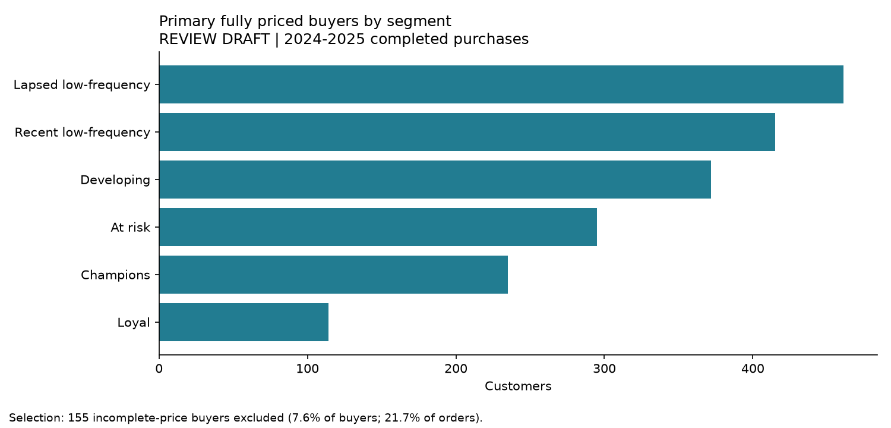
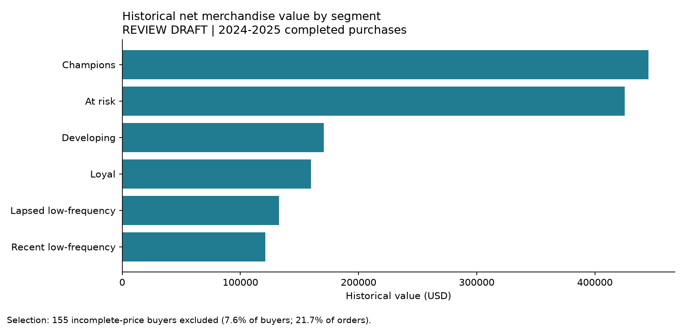

# RFM Customer Segmentation | E-commerce Analysis

**Python · Pandas · Data Analysis · Customer Segmentation · HTML Dashboard**

Analyzed e-commerce purchasing behavior using **Recency, Frequency, and Monetary (RFM)** analysis to identify customer segments and explore retention opportunities.

## Key findings

- **1,892 customers** analyzed across **6 RFM segments**
- **6,622 completed orders** included in the primary analysis
- **$1.45M** in historical purchase value
- **295 at-risk customers** identified for potential retention efforts

## Project highlights

- Cleaned and combined customer, order, and product data
- Calculated RFM metrics and classified customers into segments
- Generated visualizations and an interactive HTML dashboard
- Explored customer inactivity and retention opportunities

## Visualizations

## Tools & technologies

`Python` `Pandas` `NumPy` `Matplotlib` `SQLite` `HTML` `JavaScript`

## Project notes

**My contribution:** Defined analytical requirements, guided AI-assisted analysis and Codex development, and tested the resulting dashboard.

**Dataset:** Data Career School e-commerce case study. Original data is excluded because redistribution permission is unconfirmed. The findings are historical and have not been independently validated.

See [Review Checklist](REVIEW_CHECKLIST.md) for limitations and remaining verification steps.
